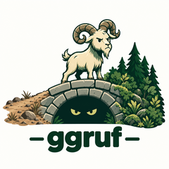

<!-- README.md is generated from README.Rmd. Please edit that file -->

# ggruf 

> “Who’s that tripping over my bridge?”

`ggruf` is a small, pure R helper package for `llama.cpp` and GGUF
models. Most R tooling for local models defaults to Ollama and bundles
its own inference engine. `ggruf` does neither: no compiled code, no
bundled `llama.cpp`, no chat interface. It is the bridge between R and
the `llama.cpp` setup you already have.

## Install

``` r
pak::pak("frankiethull/ggruf")
```

## The three goats

**Find** what’s on your machine:

``` r
library(ggruf)

gguf_dirs()          # where will it look?
models <- find_gguf_models()
models
```

Files are identified by GGUF magic bytes, so extensionless files count.
The llama.cpp download cache and `~/models` are scanned, and Ollama’s
blob store too, where manifest files are read to turn `sha256-...` blob
names back into model names like `llama3.2:latest`.

**Inspect** a file without loading it:

``` r
gguf_info(models$path[1])
gguf_metadata(models$path[1])[["general.name"]]
cat(gguf_chat_template(models$path[1]))
```

The metadata reader is pure R: architecture, quant, trained context
length, layers, tensor count, straight from the GGUF header.

**Serve** a model with `llama-server`, from R:

``` r
srv <- server_start(models[1, ], n_gpu_layers = 99)
srv

server_health(srv)
server_models(srv)
```

now chat with it, for example with ellmer:

``` r
ellmer::chat_llamacpp(model = server_models(srv)$id[1])
```

if no model is specified in chat_llamacpp, it will default to the model
you initiated the server with:

``` r
> library(ellmer)
> chat <- chat_llamacpp()
Using loaded model: "/home/frankiethull/.cache/llama.cpp/ggml-org_gemma-3-1b-it-GGUF_gemma-3-1b-it-Q4_K_M.gguf"
> chat$chat("hello")
Hello there! How’s your day going so far? 😊 

Is there anything you’d like to chat about, or any questions you have?
```

to stop the server from R:

``` r
server_stop(srv)
```

`llama_server_cmd(models[1, ])` gives you the same server as a shell
command, if you’d rather run it in a terminal. `llama_bin()` and
`llamacpp_version()` help find and check your `llama.cpp` build.

## What ggruf is not

No inference, no chat, no bundled binaries, no Ollama server API.
Helpers only.
